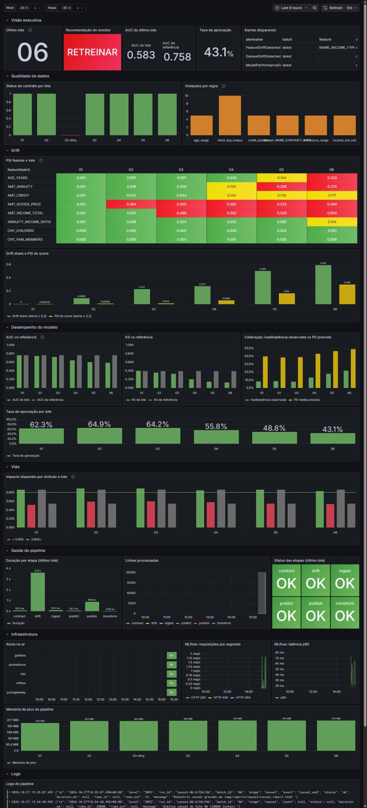
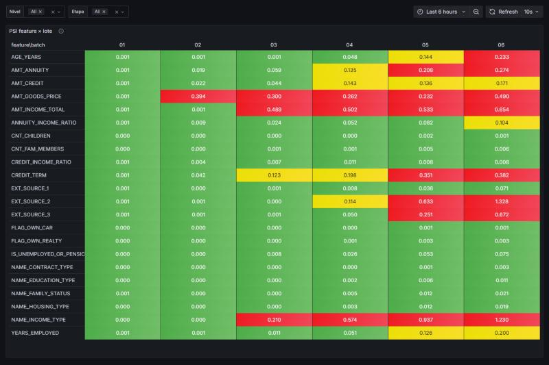
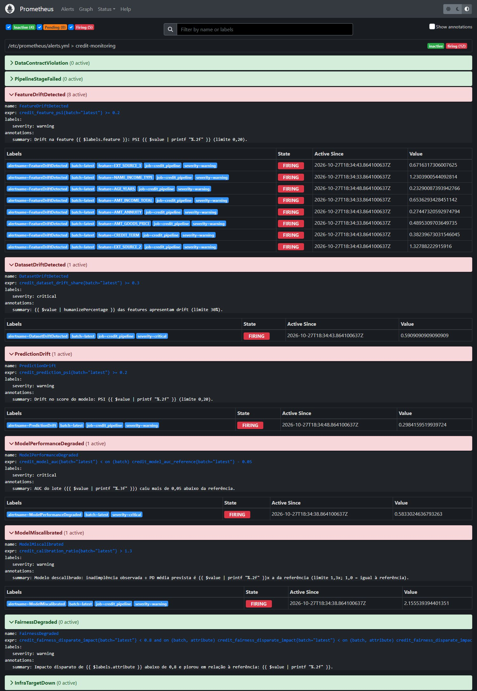
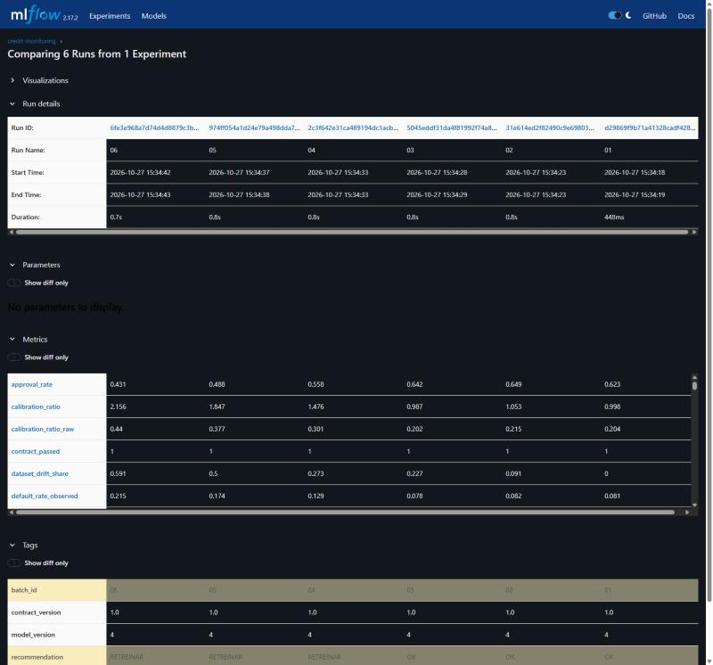
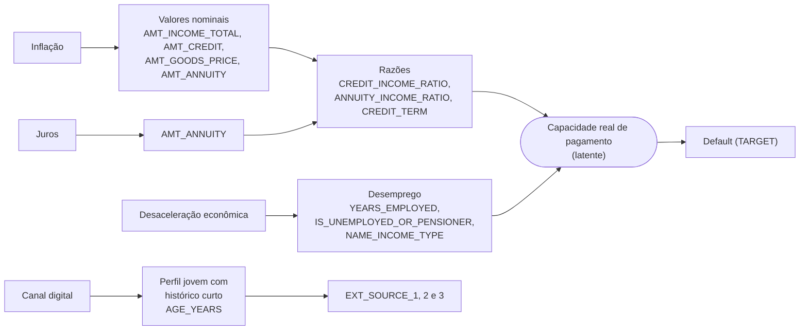

# Monitoramento contínuo de um modelo de Credit Scoring

Tech Challenge, Fase 4 (pós-graduação em MLOps). Projeto individual de João Belletati.

Este repositório constrói a camada de **sustentação e confiabilidade** de um modelo de credit scoring de
uma fintech: contrato de dados que bloqueia lotes ruins, simulação de degradação ao longo de seis meses
(data drift e concept drift), detecção com Evidently e PSI/KS próprios, observabilidade (MLflow,
Prometheus, Grafana, Loki), governança sob a LGPD, auditoria de viés e análise causal da degradação.
Tudo roda em contêineres, com comandos `docker compose` para PowerShell.

| Critério de avaliação | Peso | Onde está neste README |
|---|---|---|
| Validação de dados (Pandera) | 25% | [4.1 Contrato de dados](#41-etapa-1-contrato-de-dados-e-modelo-base) |
| Detecção de drift | 25% | [4.2 Drift](#42-etapa-2-simulação-e-detecção-de-drift) |
| Observabilidade e logs | 20% | [4.3 Observabilidade](#43-etapa-3-observabilidade) e [5. Catálogo de métricas](#5-catálogo-de-métricas) |
| Governança, LGPD e viés | 15% | [6. Governança e LGPD](#6-governança-e-lgpd), [7. Viés](#7-viés) e [8. Análise causal](#8-análise-causal) |
| Vídeo STAR (até 5 min) | 15% | [10. Vídeo](#10-vídeo) e [roteiro](docs/roteiro-video.md) |

**Transparência sobre os dados.** Os números deste documento vêm da execução completa sobre o
`application_train.csv` real do Home Credit Default Risk (307.511 linhas). A tabela por lote e todos os
valores citados estão em [`docs/evidence/RESULTADOS.md`](docs/evidence/RESULTADOS.md) e nos JSON de
`docs/evidence/`. **Os rótulos dos lotes `04` a `06` são sintéticos**: o concept drift é injetado pela
simulação (alguns `TARGET = 0` são virados para `1`). A base original não foi alterada.

---

## 1. Problema

Um modelo de crédito é treinado uma vez e vai para produção. Depois disso o mundo muda: a inflação
infla valores nominais, o desemprego sobe, entra um perfil novo de cliente (mais jovem, com histórico
curto) e o próprio comportamento de pagamento muda. O modelo continua respondendo sem erro nenhum, mas
passa a decidir pior. Essa é a **degradação silenciosa**: nenhum alarme de infraestrutura dispara, o rótulo
(inadimplência) só chega meses depois e, quando o prejuízo aparece, já é tarde.

Por cima disso há dois riscos que a fintech também precisa controlar:

- **Dados ruins entrando no pipeline** (renda nula, idade de 15 anos, IDs duplicados, categorias novas),
  que contaminam métricas e decisões sem que ninguém perceba.
- **Obrigações legais e éticas** sobre um tratamento de dados pessoais que gera decisão automatizada de
  crédito (LGPD) e pode discriminar grupos (por exemplo, por idade).

O desafio pede três capacidades técnicas, mais governança:

1. **Validação de dados:** um contrato que intercepta anomalias antes de qualquer transformação.
2. **Detecção de drift:** simular a degradação e detectá-la com evidência estatística.
3. **Observabilidade:** dashboard, logs e alertas que mostram a degradação a quem opera o modelo.
4. **Governança:** privacidade by design, plano de proteção de dados, viés e causalidade.

## 2. Arquitetura

### 2.1 Serviços

Seis serviços no `docker-compose.yml`, todos publicados apenas em `127.0.0.1`:

| Serviço | Função | Porta padrão |
|---|---|---|
| `pipeline` | Imagem Python com o pacote `credit_monitor`. Roda sob demanda (`docker compose run --rm pipeline <comando>`) | n/a |
| `mlflow` | Tracking server (SQLite e artefatos em volume), com `--expose-prometheus` | 5000 |
| `pushgateway` | Recebe as métricas de cada execução batch | 9091 |
| `prometheus` | Coleta o Pushgateway e as métricas dos demais serviços; avalia `infra/prometheus/alerts.yml` | 9090 |
| `grafana` | Datasources (Prometheus e Loki) e dashboard provisionados pelo repositório | 3000 |
| `loki` | Recebe os logs do pipeline por HTTP, sem agente | 3100 |

### 2.2 Fluxo

```
  download ─► prepare ─► train
                │           │   contrato na referência, treino, auditoria de viés,
                │           │   registro `credit-scoring` (alias `production`) no MLflow
                ▼           ▼
        lotes 01..06,    modelo production
        03-dirty (+ manifest.json por lote)
                │
                ▼
  monitor --batch N:   ingestão ─► contrato ─┬─► (falha) quarentena + relatório + métrica + alerta
                      (pseudonimiza)          │            e o lote NÃO é pontuado
                                              │
                                              └─► transformação ─► predição ─► drift / desempenho / viés
                                                                                   │
                           ┌───────────────────────────────────────────────────────┤
                           ▼                     ▼                    ▼            ▼
                    Pushgateway ─► Prometheus   Loki ─► Grafana     MLflow     reports/ (HTML e JSON)
                    (métricas)     (alertas)    (logs)  (dashboard) (1 run/lote)
```

Se MLflow, Pushgateway ou Loki não responderem, o pipeline registra um `WARN` e segue (timeout de 2 s e
desativação após a primeira falha). Os logs JSONL e os relatórios HTML em `reports/` são sempre gravados.

### 2.3 Estrutura do repositório

| Caminho | Conteúdo |
|---|---|
| `src/credit_monitor/` | Pacote: `contracts/` (Pandera), `data/` (download, preparo, simulação), `model/` (features, treino, viés), `drift/` (PSI/KS, Evidently, causal), `privacy/` (pseudonimização, retenção), `observability/` (logs, métricas, MLflow, etapas), `pipeline.py` |
| `infra/` | Prometheus (`prometheus.yml`, `alerts.yml`), Grafana (provisionamento e dashboard), Loki, imagem do MLflow |
| `tests/` | Suíte pytest (176 testes passam), com gerador de dados sintéticos no mesmo schema |
| `docs/evidence/` | Cópia versionada dos relatórios finais, das capturas de tela e do `RESULTADOS.md` |
| `docs/superpowers/specs/` | Spec de design (fonte dos requisitos e das decisões) |
| `docs/roteiro-video.md` | Roteiro STAR do vídeo |

## 3. Como rodar

Pré-requisitos: Docker Desktop. Os comandos abaixo são para PowerShell, na raiz do repositório. O
`Makefile` existe só como atalho para Linux, macOS e WSL; nada depende dele.

### 3.1 Configuração

```powershell
Copy-Item .env.example .env
# edite o .env: troque PSEUDONYMIZATION_SALT e GF_SECURITY_ADMIN_PASSWORD
docker compose up -d --build mlflow pushgateway prometheus grafana loki
```

O `PSEUDONYMIZATION_SALT` é obrigatório: com salt vazio a pseudonimização é rejeitada, porque o hash
ficaria reversível. O usuário do Grafana é `admin`, com a senha de `GF_SECURITY_ADMIN_PASSWORD`.

**Portas.** Os padrões são Grafana 3000, Prometheus 9090, MLflow 5000, Loki 3100 e Pushgateway 9091.
Se outra stack já ocupa alguma, sobrescreva no `.env` (`GRAFANA_PORT`, `PROMETHEUS_PORT`, `MLFLOW_PORT`,
`LOKI_PORT`, `PUSHGATEWAY_PORT`; ver o `.env.example`). Por exemplo, `GRAFANA_PORT=13000` faz o Grafana
responder em `http://localhost:13000`. Os endereços entre contêineres não mudam.

| Interface | Endereço padrão |
|---|---|
| Grafana (dashboard "Credit Model Monitoring") | http://localhost:3000 |
| Prometheus (alertas em `/alerts`) | http://localhost:9090 |
| MLflow | http://localhost:5000 |

### 3.2 Dataset: dois caminhos, mais uma demo sem Kaggle

O projeto usa apenas o `application_train.csv` do
[Home Credit Default Risk](https://www.kaggle.com/competitions/home-credit-default-risk) (a conta do Kaggle
precisa ter aceitado as regras da competição).

| Caminho | Como |
|---|---|
| **A. Download pela API** | Preencha `KAGGLE_USERNAME` e `KAGGLE_KEY` no `.env` e rode `docker compose run --rm pipeline download` |
| **B. Arquivo manual** | Coloque o CSV em `data/raw/application_train.csv`. O `download` só confere se ele existe |
| **C. Demo sem Kaggle** | `docker compose run --rm pipeline prepare --synthetic [--n 60000]` gera uma base sintética com o mesmo schema. O fluxo inteiro roda e é testado sem dataset real (o CI usa a mesma base) |

### 3.3 Execução completa

```powershell
docker compose run --rm pipeline download            # caminhos A/B; pule se usar --synthetic
docker compose run --rm pipeline prepare             # ou: prepare --synthetic
docker compose run --rm pipeline train
docker compose run --rm pipeline reset-metrics       # demo limpa: apaga os grupos do Pushgateway
docker compose run --rm pipeline simulate-all        # 01, 02, 03-dirty, 03, 04, 05, 06
docker compose run --rm pipeline causal              # análise causal sobre o lote 06
```

| Comando | O que faz |
|---|---|
| `download` | Baixa o CSV pela API do Kaggle ou confere o arquivo manual |
| `prepare [--synthetic] [--n]` | Aplica o contrato à base bruta e grava as falhas reais, limpa a referência, faz o split (referência 60%: treino 70%, validação 15%, teste 15%; pool de produção 40%) e gera os lotes e o `03-dirty` com `manifest.json` |
| `train` | Valida a referência, treina o XGBoost, avalia, faz a auditoria de viés e registra o modelo |
| `monitor --batch <id>` | Roda a esteira mensal para um lote (código de saída 1 se bloqueado, 2 se faltar modelo ou lote) |
| `simulate-all [--interval 20s]` | Roda os sete lotes em sequência, opcionalmente espaçados (bom para gravar o Grafana ao vivo) |
| `causal [--batch 06]` | Decomposição, ablação e SHAP; grava `reports/causal/causal_report.{html,json}` |
| `reset-metrics` | Apaga os grupos do Pushgateway |
| `purge` | Aplica a política de retenção (quarentena e logs) |

Testes e lint (sem subir a infraestrutura; o pipeline degrada com graça):

```powershell
docker compose run --rm --no-deps --entrypoint pytest pipeline
docker compose run --rm --no-deps --entrypoint ruff pipeline check .
```

O CI (GitHub Actions) roda `ruff`, `pytest` (dados sintéticos) e `promtool check rules` sobre o
`alerts.yml`.

## 4. Etapas 1 a 3, com evidências

Todos os relatórios abaixo estão versionados em [`docs/evidence/`](docs/evidence/index.html): o índice
`index.html` liga a tabela por lote aos relatórios de cada um.

### 4.1 Etapa 1: contrato de dados e modelo base

**Contrato** (`src/credit_monitor/contracts/schema.py`, versão `1.0`). São regras rígidas e bloqueantes,
aplicadas ao lote antes de qualquer transformação, com `lazy=True` (todas as falhas de uma vez). O `name`
de cada check é o rótulo estável `rule` das métricas e dos relatórios.

| Rótulo da regra | O que exige |
|---|---|
| `client_key_unique` | `client_key` sem duplicados (conta toda linha duplicada, então um par vale 2) |
| `client_key_not_null` | `client_key` não nulo |
| `income_not_null` | `AMT_INCOME_TOTAL` não nulo |
| `income_range` | `AMT_INCOME_TOTAL` maior que 0 e no máximo 10.000.000 |
| `age_range` | Idade derivada de `DAYS_BIRTH` entre 18 e 100 anos |
| `days_employed_valid` | `DAYS_EMPLOYED` menor ou igual a 0, ou o sentinela `365243` |
| `credit_positive` | `AMT_CREDIT` maior que 0 |
| `annuity_not_null`, `annuity_positive` | `AMT_ANNUITY` não nulo e maior que 0 |
| `ext_source_range` | `EXT_SOURCE_1/2/3` em `[0, 1]` quando presentes |
| `domain_<coluna>` | Categóricas no domínio da referência limpa: as 7 categóricas das features e `CODE_GENDER` em `{F, M}` |
| `target_binary` | `TARGET`, se presente, em `{0, 1}` (a coluna é opcional) |
| `min_rows` | Lote com pelo menos 1.000 linhas |
| `column_missing`, `dtype_coercion`, `validation_error` | Rótulos nativos normalizados: coluna obrigatória ausente, tipo que não converte e erro inesperado de validação (o lote segue bloqueado, e o erro vai para o log) |

**Bloqueio.** Se qualquer regra falha, o lote inteiro é bloqueado: é **copiado** (não movido) para
`data/quarantine/<lote>.parquet`, o relatório de falhas é gravado (`<lote>_failures.html` e `.json`, com
regra, coluna, valor ofensor e `client_key`, nunca o ID bruto), as métricas `contract_passed = 0` e
`contract_violations{rule}` são publicadas, o run do MLflow recebe `status=blocked` e o log sai como
`ERROR`. Predição e drift **não** rodam para esse lote. Como a cópia não remove o original, reexecutar o
lote bloqueia de novo. O estágio fica com `pipeline_stage_status = -1` (bloqueado), valor distinto de `0`
(exceção), para que `PipelineStageFailed` não duplique `DataContractViolation`.

**Evidências reais:**

| Verificação | Resultado |
|---|---|
| Contrato sobre a base bruta (307.511 linhas) | 19 linhas ofensoras removidas na limpeza: `annuity_not_null` 12, `domain_CODE_GENDER` 4 (valor `XNA`), `income_range` 3. Relatório: [`raw_reference_failures.html`](docs/evidence/contracts/raw_reference_failures.html) |
| Lote `03-dirty` (cópia do `03` com defeitos injetados) | **Bloqueado** com exatamente as 6 regras esperadas: `client_key_unique` (10), `ext_source_range` (5), `age_range` (5), `credit_positive` (5), `domain_NAME_CONTRACT_TYPE` (5), `income_not_null` (5). Relatório: [`03-dirty_failures.html`](docs/evidence/contracts/03-dirty_failures.html) |
| Lotes `01` a `06` | Todos passam no contrato |

**Modelo base** (`XGBClassifier` num `Pipeline` do scikit-learn, `scale_pos_weight = neg/pos`, early
stopping na validação, `SEED = 42`). No conjunto de teste da referência:

| Métrica | Valor |
|---|---|
| ROC-AUC | 0,7577 |
| KS | 0,390 |
| PR-AUC | 0,239 |
| Brier | 0,186 |
| Ponto de corte de aprovação | 0,4494 (maximiza KS na validação; aprova se a PD for menor que o corte) |

`CODE_GENDER` nunca é feature: só entra na auditoria de viés.

### 4.2 Etapa 2: simulação e detecção de drift

**Simulação** (`config.DRIFT_SCHEDULE`, `data/simulate.py`). Seis lotes mensais de 20.000 linhas, com
drift progressivo, mais o `03-dirty`.

| Lote | Inflação: renda / crédito e preço do bem / anuidade | Desempregados | Novo perfil (jovem, histórico curto) | Concept drift (fração virada para 1) |
|---|---|---|---|---|
| 01 | 0 / 0 / 0 | referência | não | 0 |
| 02 | +2% / +4% / +6% | referência | não | 0 |
| 03 | +5% / +10% / +14% | 22% | não | 0 |
| 04 | +8% / +16% / +22% | 25% | leve | 10% |
| 05 | +10% / +20% / +28% | 28% | moderado | 18% |
| 06 | +12% / +25% / +35% | 30% | forte | 25% |

Premissas e decisões de modelagem:

- **Lotes mensais independentes.** Cada lote é sorteado do pool inteiro, sem reposição dentro do lote
  (uma mesma linha pode aparecer em meses diferentes). Com amostragem disjunta, o viés de idade de cada
  mês dependia do que os meses anteriores já tinham consumido: os jovens acabavam antes do `04`, e o
  drift de idade saía na direção errada.
- **Premissa de rótulos.** O rótulo chega junto com o lote. Em produção o rótulo chegaria com atraso;
  por isso o dashboard separa sinais **sem rótulo** (drift de dados e de predição) dos sinais **com rótulo**
  (desempenho e calibração). Um lote sem `TARGET` pula as métricas com rótulo.
- **Concept drift sintético.** No segmento "espremido" (`ANNUITY_INCOME_RATIO` acima do p75 da referência
  ou desempregado), parte dos `TARGET = 0` vira `1`: 899 linhas no `04`, 1.723 no `05`, 2.518 no `06`.
  Os rótulos originais ficam em `labels_original.parquet`, invisíveis ao monitoramento, e só o `causal`
  os usa.
- **`injected_features` x `drifted_features`.** Cada `manifest.json` guarda a **verdade-base**
  `injected_features` (toda feature que os parâmetros do lote tocam, detectável ou não) e
  `drifted_features` (o subconjunto em que se espera drift detectável, usado no teste de recall). Foi
  essa separação que mostrou que a inflação de renda de +12% é injetada, mesmo fora do conjunto
  prometido.

**Método de detecção** (`src/credit_monitor/drift/stats.py` e `detect.py`):

| Elemento | Como funciona |
|---|---|
| **PSI** | 10 bins por quantil da referência; categóricas por categoria (com `__missing__` e categorias novas); `eps` nas proporções, então o PSI é sempre finito, mesmo com referência constante ou coluna toda nula. Limiares: atenção 0,10, drift 0,20 |
| **Bins robustos a empate** | Cada borda numérica fica no **ponto médio entre o corte do quantil e o próximo valor da grade de 100 percentis da referência** acima dele. Assim nenhuma massa de empate fica sobre uma borda |
| **KS** | Estatística D do `ks_2samp` nas numéricas. A regra usa o **tamanho do efeito (D > 0,10), não o p-valor**: com cerca de 20 mil linhas por lote, o p-valor satura e acusa drift em qualquer diferença trivial |
| **Regra de drift por feature** | PSI ≥ 0,20 **ou** KS D > 0,10 |
| **Drift share** | Fração das 22 features com drift; alerta com ≥ 0,30 |
| **PSI do score** | Mesmo PSI sobre a PD prevista; alerta com ≥ 0,20 |
| **Desempenho** | AUC, KS, taxa de aprovação, inadimplência observada e PD média prevista. Alerta se AUC < AUC de referência − 0,05 |
| **Calibração relativa** | `calibration_ratio` = (inadimplência observada / PD média prevista do lote) dividido pelo mesmo quociente na referência. 1,0 = calibração igual à da referência. Alerta se > 1,3 |
| **Evidently** (0.7.23) | `DataDriftPreset(method="psi")` e `ClassificationPreset`, referência contra lote, como relatórios HTML/JSON de evidência. A fonte dos alertas é o PSI/KS próprio |

**Por que o PSI com bins por ponto médio.** Renda e preço do bem concentram-se em valores redondos
(112.500, 135.000, 157.500...). Com cortes de quantil caindo exatamente sobre essas massas, até a
inflação de 2% do lote `02` trocava de bin massas inteiras (PSI da renda 0,491): um artefato de medição,
não drift. Com a correção, referência contra referência inflada na renda real:

| Inflação uniforme | PSI antes | PSI depois |
|---|---|---|
| +2% | 0,470 | 0,001 |
| +5% | 0,496 | 0,473 |
| +12% | 0,193 | 0,620 |

**Alcance preciso da correção.** Ela remove o artefato "massa de empate sobre a borda" **apenas para
deslocamentos menores que a distância entre dois níveis de preço consecutivos**. Quando o deslocamento é
maior (+5%, por exemplo), a massa cruza a borda de verdade e o PSI sobe, o que é medição legítima. Por isso
o `AMT_GOODS_PRICE`, cujos valores são redondos, continua com PSI **não monotônico** entre os lotes
(0,394 no `02`, 0,300, 0,262, 0,232 e 0,490 no `06`): com `credit_infl` de 4% a massa já cruza bordas. A
renda ficou monotônica nos seis lotes (0,001, 0,001, 0,489, 0,502, 0,533, 0,654).

**KS é hipersensível em variável discretizada.** Em variável com poucos níveis, deslocar uma massa de
empate move a CDF de uma vez. A renda no lote `02` tem D = 0,119 (acima de 0,10) com PSI 0,001, e portanto
é marcada como drift já no `02`, só pelo KS. É drift injetado de verdade (+2%), com limiar fixo, então
foi mantido e documentado. Efeito prático: o `FeatureDriftDetected` do Prometheus (PSI ≥ 0,20) só lista a
renda a partir do `03`, e a recomendação do `02` segue `OK`.

**Resultado por lote** (dataset real; calibração relativa à referência):

| Lote | Features com drift | Drift share | PSI do score | AUC | KS | Calibração | Aprovação | Recomendação |
|---|---|---|---|---|---|---|---|---|
| 01 | 0 | 0,0% | 0,000 | 0,7585 | 0,394 | 0,998 | 62,3% | OK |
| 02 | 2 | 9,1% | 0,008 | 0,7413 | 0,357 | 1,053 | 64,9% | OK |
| 03-dirty | bloqueado pelo contrato (não pontuado) | | | | | | | |
| 03 | 5 | 22,7% | 0,011 | 0,7222 | 0,328 | 0,987 | 64,2% | OK |
| 04 | 6 | 27,3% | 0,057 | 0,6381 | 0,201 | 1,476 | 55,8% | **RETREINAR** |
| 05 | 11 | 50,0% | 0,162 | 0,5998 | 0,144 | 1,847 | 48,8% | **RETREINAR** |
| 06 | 13 | 59,1% | 0,298 | 0,5833 | 0,124 | 2,156 | 43,1% | **RETREINAR** |

Leituras que importam:

- O **AUC** já cai mais de 0,05 e a calibração já passa de 1,3 no `04`, quando os sinais **sem rótulo**
  ainda não cruzaram nenhum limiar de dataset (drift share 27,3% e PSI do score 0,057). O drift share só
  chega a 0,30 no `05`, e o PSI do score só passa de 0,20 no `06`. Por isso o monitor combina os dois tipos
  de sinal: quem espera o rótulo ganha precisão, quem não espera ganha tempo.
- No `06`, o AUC é 0,5833, uma queda de 0,1744 em relação à referência (0,7577).
- **Por que a calibração é relativa.** A inadimplência observada sobre a PD média prevista é 0,204 já
  na referência, porque o modelo foi treinado com `scale_pos_weight` e a saída não é uma probabilidade
  calibrada (a PD é inflada). Um limiar absoluto de 1,3 sobre o valor bruto seria sem sentido. No `06` o
  bruto é 0,440 (inadimplência observada 21,5% contra PD média 48,8%), que equivale a 2,156 vezes o
  quociente da referência.
- **Recomendação.** `RETREINAR` se houver alerta de desempenho ou de calibração. `INVESTIGAR` se houver drift
  de dataset, de predição ou alerta de viés, sem queda de desempenho. Senão, `OK`.

**Injetado x detectado no lote `06`** (14 features injetadas, 13 detectadas):

| Feature injetada | PSI | KS (D) | Esperada no manifest | Detectada |
|---|---|---|---|---|
| AGE_YEARS | 0,233 | 0,221 | sim | sim |
| AMT_ANNUITY | 0,274 | 0,225 | sim | sim |
| AMT_CREDIT | 0,171 | 0,123 | sim | sim (KS) |
| AMT_GOODS_PRICE | 0,490 | 0,162 | sim | sim |
| AMT_INCOME_TOTAL | 0,654 | 0,148 | não | sim (PSI e KS) |
| ANNUITY_INCOME_RATIO | 0,104 | 0,137 | não | sim (KS) |
| CREDIT_INCOME_RATIO | 0,008 | 0,042 | não | **não** (infla junto com a renda; efeito líquido pequeno) |
| CREDIT_TERM | 0,382 | 0,251 | sim | sim |
| EXT_SOURCE_1 | 0,071 | 0,123 | não | sim (KS) |
| EXT_SOURCE_2 | 1,328 | 0,300 | sim | sim |
| EXT_SOURCE_3 | 0,672 | 0,231 | sim | sim |
| IS_UNEMPLOYED_OR_PENSIONER | 0,075 | 0,116 | sim | sim (KS) |
| NAME_INCOME_TYPE | 1,230 | n/a (categórica) | sim | sim |
| YEARS_EMPLOYED | 0,200 | 0,168 | sim | sim |

Recall sobre o `drifted_features` do manifest: 10 de 10 no `06`, e **nenhuma feature sem injeção foi
sinalizada** (zero falso positivo sobre o conjunto não tocado). A renda foi detectada no `06`, e o
desemprego por `YEARS_EMPLOYED`, `IS_UNEMPLOYED_OR_PENSIONER` e `NAME_INCOME_TYPE`.

Relatórios do Evidently por lote: [`01`](docs/evidence/drift/01_data_drift.html),
[`02`](docs/evidence/drift/02_data_drift.html), [`03`](docs/evidence/drift/03_data_drift.html),
[`04`](docs/evidence/drift/04_data_drift.html), [`05`](docs/evidence/drift/05_data_drift.html),
[`06`](docs/evidence/drift/06_data_drift.html) (drift de dados) e os de desempenho
([`06`](docs/evidence/drift/06_performance.html)). Os resumos estão em
[`drift/*_summary.json`](docs/evidence/drift/06_summary.json).

### 4.3 Etapa 3: observabilidade

**Instrumentação.** O context manager `stage(name, batch)` envolve cada etapa (`ingest`, `contract`,
`transform`, `predict`, `drift`, `publish`): mede duração, status e linhas de entrada e saída, emite log e
registra as métricas. O pipeline mede ainda a memória de pico (cerca de 470 MiB por lote nos dados reais).

**Logs** (`observability/logging.py`). JSON por linha com `ts, level, run_id, batch_id, stage, event,
status, duration_ms, rows_in, rows_out, message`, em três destinos: stdout, `reports/logs/pipeline.jsonl`
e Loki (`/loki/api/v1/push`, labels `job`, `stage`, `level`, `batch`). Nunca contêm dados de linha.

**Métricas e agrupamento.** Cada execução publica no Pushgateway o grupo `{job="credit_pipeline",
batch=<id>}` (histórico) **e** o grupo `{batch="latest"}` (sobrescrito). Os alertas olham só para
`batch="latest"`. O label `batch` vem só da *grouping key*; o lote real do grupo `latest` aparece em
`credit_batch_info{batch_id}`. Catálogo completo na [seção 5](#5-catálogo-de-métricas).

**Alertas** (`infra/prometheus/alerts.yml`, `for: 0m`, exceto `InfraTargetDown`). Detalhes na seção 5.
No estado final (`latest` = `06`) **12 alertas disparam**: `FeatureDriftDetected` (8 séries: AMT_INCOME_TOTAL,
AMT_ANNUITY, AMT_GOODS_PRICE, CREDIT_TERM, EXT_SOURCE_2, EXT_SOURCE_3, NAME_INCOME_TYPE, AGE_YEARS),
`DatasetDriftDetected` (0,591), `PredictionDrift` (0,298), `ModelPerformanceDegraded` (AUC 0,583) e
`ModelMiscalibrated` (2,156). `FairnessDegraded`, `DataContractViolation`, `PipelineStageFailed` e
`InfraTargetDown` ficam inativos nesse estado (o `DataContractViolation` aparece quando o `03-dirty` é o
último lote).

**MLflow.** Experimento `credit-scoring-training` (parâmetros, métricas, auditoria de viés, modelo
registrado) e `credit-monitoring` (um run por lote, com tags `batch_id`, `model_version`,
`contract_version`, `status`, `recommendation`; artefatos: HTML/JSON do Evidently, falhas do contrato,
`manifest.json` e trecho do log).

**Dashboard Grafana "Credit Model Monitoring"** (provisionado em `infra/grafana/dashboards/`), em oito
seções: visão executiva, qualidade de dados, drift (heatmap PSI feature x lote), desempenho, viés, saúde do
pipeline, infraestrutura e logs (Loki, filtrável por `stage` e `level`).

#### Capturas de tela



*Dashboard completo do Grafana com o lote `06` como último (`RETREINAR`). O painel de viés mostra a
referência em barras cinzas ao lado do valor do lote, com a linha de 0,8.*



*Matriz de PSI por feature e por lote: o drift aparece progressivamente de `01` a `06`.*



*Página `/alerts` do Prometheus, com 12 alertas disparando (`FairnessDegraded` inativo).*



*Comparação dos runs `01` a `06` no experimento `credit-monitoring` do MLflow.*

## 5. Catálogo de métricas

Todas as métricas são do tipo **gauge**, com prefixo `credit_`, publicadas no Pushgateway (job
`credit_pipeline`) e identificadas sempre pelo label extra `batch` da grouping key. A tabela reproduz o
`METRIC_CATALOG` de `src/credit_monitor/observability/metrics.py`; o `MetricsPublisher` levanta
`KeyError` para métrica fora do catálogo.

| Métrica | Tipo | Labels | Significado | Limiar | Alerta |
|---|---|---|---|---|---|
| `credit_pipeline_stage_status` | gauge | `stage` | Status da etapa: 1 sucesso, 0 erro (exceção), -1 bloqueado pelo contrato | `== 0` | `PipelineStageFailed` |
| `credit_pipeline_stage_duration_seconds` | gauge | `stage` | Duração da etapa, em segundos | n/a | n/a |
| `credit_pipeline_rows_processed` | gauge | `stage` | Linhas de saída da etapa | n/a | n/a |
| `credit_pipeline_last_success_timestamp` | gauge | n/a | Timestamp Unix da última execução concluída com sucesso | n/a | n/a |
| `credit_pipeline_peak_memory_bytes` | gauge | n/a | Memória de pico do pipeline, em bytes | n/a | n/a |
| `credit_batch_info` | gauge | `batch_id` | Lote publicado no grupo `latest` (valor sempre 1) | n/a | n/a |
| `credit_contract_passed` | gauge | n/a | Contrato de dados: 1 passou, 0 violado | `== 0` | `DataContractViolation` |
| `credit_contract_violations` | gauge | `rule` | Violações do contrato por regra | n/a | n/a (detalha o alerta acima) |
| `credit_feature_psi` | gauge | `feature` | PSI da feature contra a referência | atenção 0,10; drift `>= 0,20` | `FeatureDriftDetected` |
| `credit_feature_ks` | gauge | `feature` | Estatística D do KS da feature contra a referência | drift `> 0,10` (conta para o drift share) | n/a (via `DatasetDriftDetected`) |
| `credit_dataset_drift_share` | gauge | n/a | Fração de features com drift | `>= 0,30` | `DatasetDriftDetected` |
| `credit_prediction_psi` | gauge | n/a | PSI do score contra a referência | `>= 0,20` | `PredictionDrift` |
| `credit_model_auc` | gauge | n/a | AUC do modelo no lote | `< referência - 0,05` | `ModelPerformanceDegraded` |
| `credit_model_ks` | gauge | n/a | KS do modelo no lote | n/a | n/a |
| `credit_default_rate_observed` | gauge | n/a | Taxa de inadimplência observada no lote | n/a | n/a |
| `credit_mean_predicted_pd` | gauge | n/a | PD média prevista no lote | n/a | n/a |
| `credit_calibration_ratio` | gauge | n/a | Calibração relativa: (observado / PD média prevista) do lote dividido pelo mesmo quociente na referência | `> 1,3` | `ModelMiscalibrated` |
| `credit_approval_rate` | gauge | n/a | Taxa de aprovação no lote | n/a | n/a |
| `credit_monitor_recommendation` | gauge | n/a | Recomendação do monitor: 0 `OK`, 1 `INVESTIGAR`, 2 `RETREINAR` | n/a | n/a |
| `credit_model_auc_reference` | gauge | n/a | AUC do modelo na base de referência | n/a | n/a (base do alerta de AUC) |
| `credit_model_ks_reference` | gauge | n/a | KS do modelo na base de referência | n/a | n/a |
| `credit_fairness_disparate_impact` | gauge | `attribute` (`gender`, `age_band`) | Impacto disparato da aprovação (menor taxa / maior taxa) | `< 0,8` **e** piora maior que 0,05 sobre a referência | `FairnessDegraded` |
| `credit_fairness_disparate_impact_reference` | gauge | `attribute` | Impacto disparato na base de referência | base da comparação acima | n/a |

Fora do catálogo, o Prometheus coleta `up{job}` (5 alvos: Pushgateway, Prometheus, MLflow, Grafana e
Loki) e as métricas nativas do MLflow (`mlflow_http_request_*`).

### 5.1 Alertas

| Alerta | Expressão (sobre `batch="latest"`) | Severidade |
|---|---|---|
| `DataContractViolation` | `credit_contract_passed == 0` | critical |
| `PipelineStageFailed` | `credit_pipeline_stage_status == 0` | critical |
| `FeatureDriftDetected` | `credit_feature_psi >= 0.2` | warning |
| `DatasetDriftDetected` | `credit_dataset_drift_share >= 0.3` | critical |
| `PredictionDrift` | `credit_prediction_psi >= 0.2` | warning |
| `ModelPerformanceDegraded` | `credit_model_auc < credit_model_auc_reference - 0.05` | critical |
| `ModelMiscalibrated` | `credit_calibration_ratio > 1.3` | warning |
| `FairnessDegraded` | `credit_fairness_disparate_impact < 0.8` **e** `< credit_fairness_disparate_impact_reference - 0.05` | warning |
| `InfraTargetDown` | `up == 0` por 1 minuto | critical |

Não há Alertmanager: os alertas disparam no Prometheus e aparecem no Grafana (fora do escopo, junto
com o retreino automático e a API online).

## 6. Governança e LGPD

### 6.1 Privacy by design e by default (implementado)

Cada medida está ligada ao arquivo que a implementa e, quando há, ao teste que a protege.

| Medida | Implementação | Onde |
|---|---|---|
| **Minimização** | `usecols`: o `prepare` lê só 21 das 122 colunas do CSV | `src/credit_monitor/config.py` (`RAW_COLUMNS`), `src/credit_monitor/data/prepare.py` |
| **Pseudonimização** | `client_key = HMAC-SHA256(PSEUDONYMIZATION_SALT, SK_ID_CURR)` (16 caracteres hex) na ingestão; salt no `.env`; salt vazio é rejeitado | `src/credit_monitor/privacy/pseudonymize.py` |
| **Observabilidade sem dado individual** | Logs com campos fixos e sem linhas; catálogo fechado de métricas, só agregados; falhas do contrato citam `client_key`, nunca o ID bruto | `src/credit_monitor/observability/logging.py`, `observability/metrics.py`, `contracts/validate.py`. Testes: `tests/test_pipeline.py::test_no_raw_ids_leak` e `tests/test_contracts.py::test_failures_never_contain_raw_id`. Varredura nos arquivos de evidência reais: [`RESULTADOS.md`, observação 6](docs/evidence/RESULTADOS.md) |
| **Atributo de risco fora do modelo** | `CODE_GENDER` só na auditoria de viés, fora de `MODEL_FEATURES` | `src/credit_monitor/config.py`, `src/credit_monitor/model/fairness.py` |
| **Retenção executável** | `purge`: quarentena maior que 30 dias e logs maiores que 90 dias; Loki com `retention_period: 2160h` (90 dias); Prometheus com `--storage.tsdb.retention.time=395d` | `src/credit_monitor/privacy/retention.py` (`RETENTION_DAYS` em `config.py`), `infra/loki/loki-config.yml`, `docker-compose.yml` |
| **Segurança** | `data/`, `reports/`, `models/` e `.env` no `.gitignore`; segredos via `.env`; portas só em `127.0.0.1` | `.gitignore`, `.env.example`, `docker-compose.yml` |

Ressalva honesta: o pool de produção e os lotes em `data/` guardam `SK_ID_CURR`, porque representam o
sistema de origem (e o contrato valida o `client_key` derivado). Tudo que sai desse ponto (contrato,
modelo, métricas, logs, MLflow, relatórios) usa só `client_key`, e a referência já é gravada
pseudonimizada. `data/` não é versionado.

### 6.2 Plano de proteção de dados

**Aviso.** As citações legais abaixo são referência acadêmica para um trabalho de pós-graduação, **não
constituem parecer jurídico**. Uma implantação real exige revisão por assessoria jurídica e pelo
encarregado (DPO).

#### Inventário e classificação dos dados

| Grupo | Colunas | Classificação | Finalidade e tratamento |
|---|---|---|---|
| Identificador | `SK_ID_CURR` | Dado pessoal (identificador direto) | Só unicidade no contrato. Pseudonimizado na ingestão e nunca vira feature |
| Financeiras | `AMT_INCOME_TOTAL`, `AMT_CREDIT`, `AMT_ANNUITY`, `AMT_GOODS_PRICE` | Dado pessoal, protegido por sigilo bancário (LC 105/2001) | Features do modelo |
| Perfil | `DAYS_BIRTH`, `DAYS_EMPLOYED`, `CNT_CHILDREN`, `CNT_FAM_MEMBERS` | Dado pessoal | Features (idade e tempo de emprego derivados) |
| Categóricas | `NAME_CONTRACT_TYPE`, `NAME_INCOME_TYPE`, `NAME_EDUCATION_TYPE`, `NAME_FAMILY_STATUS`, `NAME_HOUSING_TYPE`, `FLAG_OWN_CAR`, `FLAG_OWN_REALTY` | Dado pessoal | Features (one-hot) |
| Score externo | `EXT_SOURCE_1`, `EXT_SOURCE_2`, `EXT_SOURCE_3` | Dado pessoal derivado de terceiros | Features (nulos permitidos) |
| Gênero | `CODE_GENDER` | **Não é dado pessoal sensível** pelo art. 5º, II, mas é **vetor de discriminação** (art. 6º, IX, princípio da não discriminação) | **Fora das features**: só auditoria de viés |
| Alvo | `TARGET` | Dado pessoal (comportamento de pagamento) | Treino e métricas com rótulo |
| Derivados | `client_key`, agregados de monitoramento | `client_key`: dado pseudonimizado (ainda dado pessoal). Agregados: sem titular identificável | Contrato, logs, métricas e relatórios |

#### Base legal

O tratamento se apoia no **art. 7º, X** (proteção do crédito), combinado com o **art. 7º, V** (execução
de contrato ou de procedimentos preliminares a pedido do titular: a análise de crédito faz parte da
contratação).

**Por que não o consentimento (art. 7º, I).** O consentimento precisa ser livre e pode ser revogado a
qualquer momento. Numa decisão de crédito isso não funciona: (1) a análise de risco é condição para
contratar, então o consentimento não seria livre; (2) a revogação inviabilizaria a própria finalidade de
proteção do crédito e de gestão de risco da fintech; (3) o titular não pode "retirar" a inadimplência
passada do cálculo de risco. A base de proteção do crédito dispensa o consentimento, mas mantém todos os
princípios (finalidade, necessidade, transparência, não discriminação) e os direitos do titular.

#### Decisão automatizada (art. 20)

O titular tem direito a solicitar **revisão** de decisões tomadas unicamente com base em tratamento
automatizado que afetem seus interesses, incluindo as destinadas a definir perfil de crédito, e a obter
informações claras sobre os critérios e procedimentos usados, observados os segredos comercial e
industrial. O processo previsto:

1. A decisão de crédito do modelo é **revisável por um analista humano** a pedido do titular (ou de
   ofício nos casos limítrofes próximos ao corte).
2. A **explicação** usa contribuições SHAP por feature (`pred_contribs=True` do XGBoost, já usado em
   `src/credit_monitor/drift/causal.py` para a importância agregada), que mostram quais variáveis puxaram a
   PD para cima ou para baixo.
3. O modelo é auditado por viés a cada treino e a cada lote ([seção 7](#7-viés)).

Este repositório implementa o monitoramento e a explicação agregada; a fila de revisão humana é o
processo organizacional descrito aqui, não um serviço do projeto.

#### Direitos do titular (art. 18) e seus limites

| Direito | Como é atendido | Limite |
|---|---|---|
| Confirmação e acesso | O `client_key` permite localizar o titular nos dados do sistema de origem | Dentro do pipeline só há pseudônimo; a ligação com a pessoa fica no sistema de origem |
| Correção | Corrigir no sistema de origem; o próximo lote já reflete a correção | Lotes passados e relatórios agregados não são reescritos |
| Anonimização, bloqueio ou eliminação de dados desnecessários ou excessivos | Minimização na entrada (`usecols`) e retenção executável (`purge`) | |
| Eliminação | Pedido atendido em dados de proposta e quarentena | Pode ser negada quando houver obrigação legal ou regulatória de guarda, ou exercício regular de direitos (art. 16), e em agregados que não identificam o titular |
| Portabilidade | Exportação dos dados do titular pelo sistema de origem | Não alcança modelos, métricas e relatórios agregados |
| Informação sobre compartilhamento | Não há compartilhamento com terceiros no pipeline | O score externo (`EXT_SOURCE_*`) vem de terceiros, e isso consta do aviso de privacidade |
| Revisão de decisão automatizada | Art. 20, acima | Segredos comercial e industrial |
| Oposição | Avaliada caso a caso, quando o tratamento se apoia em base legal que não seja consentimento | A proteção do crédito é justificativa legítima para manter o tratamento |

#### Retenção

| Dado | Prazo | Como é executado |
|---|---|---|
| Dados da proposta | 5 anos após o fim da relação | Política (sistema de origem); o pipeline não guarda cópia além dos lotes simulados |
| Quarentena (`data/quarantine/`) | 30 dias | `purge` (`RETENTION_DAYS["quarantine"]`) |
| Logs (`reports/logs/` e Loki) | 90 dias | `purge` (`RETENTION_DAYS["logs"]`) e `retention_period: 2160h` no Loki |
| Métricas | 13 meses | `--storage.tsdb.retention.time=395d` no Prometheus |
| Modelos e relatórios agregados | Vida do modelo mais 5 anos | Política; contêm apenas agregados |

#### RIPD resumido (art. 38)

| Risco | Mitigação |
|---|---|
| Reidentificação por vazamento de ID bruto em logs ou métricas | Pseudonimização HMAC com salt secreto; só agregados na observabilidade; teste automatizado que varre as saídas |
| Discriminação por idade ou gênero na decisão de crédito | `CODE_GENDER` fora do modelo; teste de proxy; auditoria de viés por lote; alerta de degradação; mitigações documentadas ([seção 7](#7-viés)) |
| Decisão automatizada sem recurso | Revisão humana e explicação SHAP (art. 20) |
| Retenção além do necessário | `purge`, retenção no Loki e no Prometheus, prazos documentados |
| Exposição de segredos e dados pessoais | `.env` e `data/` fora do Git; portas em `127.0.0.1` |
| Degradação do modelo gerando decisões injustas ou financeiramente ruins | Contrato de dados, monitoramento de drift e de desempenho, recomendação de retreino |

#### Encarregado (DPO) e fluxo de incidentes

- O **encarregado** (art. 41) é o canal com os titulares e com a ANPD, aprova o RIPD e revisa mudanças
  no tratamento.
- Fluxo de incidente: (1) detectar (alerta ou relato); (2) conter (revogar acessos, trocar o salt e o
  segredo comprometido, o que invalida os pseudônimos antigos); (3) avaliar o risco ao titular com o
  encarregado; (4) comunicar a ANPD e os titulares em prazo razoável (art. 48), hoje regulamentado pela
  ANPD em 3 dias úteis, valor a confirmar com a assessoria jurídica; (5) registrar o incidente e as
  lições, e corrigir a causa.

## 7. Viés

A auditoria (`src/credit_monitor/model/fairness.py`) calcula, no treino e a cada lote: taxa de aprovação
por grupo, **impacto disparato** (menor taxa de aprovação dividida pela maior), TPR (taxa de aprovação
entre bons pagadores, `TARGET = 0`) e diferença de equal opportunity. Os grupos são gênero e faixa etária
(`<30`, `30-45`, `45-60`, `60+`). O teste de proxy mede a informação mútua de cada feature com
`CODE_GENDER`.

**Resultado na referência** (conjunto de teste, `models/metadata.json["fairness"]`):

| Atributo | Taxa de aprovação por grupo | Impacto disparato | Diferença de equal opportunity |
|---|---|---|---|
| Gênero | F 65,8%, M 56,7% | 0,861 (acima de 0,8) | 0,080 |
| Faixa etária | `<30` 42,8%; `30-45` 59,3%; `45-60` 69,8%; `60+` 79,1% | **0,541 (abaixo de 0,8)** | 0,340 |

TPR: F 0,685 e M 0,605; `<30` 0,464, `30-45` 0,629, `45-60` 0,721, `60+` 0,803. Proxy de gênero (top 5,
informação mútua): `FLAG_OWN_CAR` 0,057, `CREDIT_TERM` 0,031, `AMT_INCOME_TOTAL` 0,022, `EXT_SOURCE_1` 0,021,
`NAME_FAMILY_STATUS` 0,019.

**Série mensal** (`credit_fairness_disparate_impact`, impacto disparato por lote; referência: gênero
0,861 e idade 0,541):

| Atributo | 01 | 02 | 03 | 04 | 05 | 06 |
|---|---|---|---|---|---|---|
| Gênero | 0,865 | 0,889 | 0,890 | 0,845 | 0,861 | 0,827 |
| Faixa etária | 0,515 | 0,588 | 0,592 | 0,576 | 0,546 | 0,530 |

**Regra do alerta: degradação em relação à referência.** O impacto disparato de faixa etária já é 0,54 na
referência. Com a regra absoluta (`< 0,8`), a recomendação `INVESTIGAR` e o alerta `FairnessDegraded`
ficariam ligados desde o lote `01`, o que enterraria qualquer sinal novo. Por isso a regra é **`DI < 0,8`
e `DI < DI da referência - 0,05`** (`FAIRNESS_DEGRADATION_MARGIN`). Efeito: `01`, `02` e `03` ficam `OK`, e
`FairnessDegraded` fica inativo no `06` (idade 0,530 contra 0,541 na referência: queda de 0,011, menor que
a margem de 0,05). O painel de viés mostra a referência em barras cinzas ao lado do valor do lote.

**Achado permanente de governança.** O modelo-base tem impacto disparato por idade de **0,54**, abaixo do
piso de 0,8 da regra dos quatro quintos. Os jovens inadimplem mais na base real, então o modelo aprova menos
jovens, mas isso é um risco jurídico e ético que **não some com o monitoramento**: é um achado do modelo-base,
não do drift. O nível-base exige decisão de governança antes de ir a produção. Mitigações documentadas:

1. **Ajuste de corte por grupo**, com discussão jurídica obrigatória (tratamento diferenciado por idade).
2. **Reponderação no retreino**, dando mais peso aos grupos sub-aprovados.

## 8. Análise causal

A análise (`src/credit_monitor/drift/causal.py`, comando `causal`, lote `06`) separa o que degradou o
modelo. Ela só tem leitura causal porque a simulação controla o processo gerador dos dados: sabemos o que
foi alterado em X e quais rótulos foram invertidos. Com dados reais seriam apenas associações.

### 8.1 DAG causal



O nó "capacidade real de pagamento" é latente (não observado). No gerador, o concept drift atua justamente
no segmento "espremido" (razão anuidade/renda alta ou desempregado).

### 8.2 Decomposição da queda de AUC

| Etapa | AUC | Queda |
|---|---|---|
| AUC na referência | 0,7577 | n/a |
| AUC(X₀₆, rótulos originais): efeito da mudança em X | 0,7335 | 0,0242 (mudança nas covariáveis) |
| AUC(X₀₆, rótulos novos): efeito total | 0,5833 | 0,1744 no total |
| Contribuição do concept drift (diferença entre os dois últimos) | n/a | **0,1502** (86% da queda) |

### 8.3 Ablação por feature (top 5)

Cada feature com drift volta à distribuição de referência por mapeamento de quantis, uma por vez. Mede-se
a recuperação do PSI do score (sem ablação, no `06`, o PSI do score é 0,298), do AUC e da calibração.

| # | Feature | PSI do score após | Recuperação do PSI | AUC após | Recuperação de AUC | Calibração após |
|---|---|---|---|---|---|---|
| 1 | `EXT_SOURCE_2` | 0,081 | 73,0% | 0,5867 | +0,0193 | 2,374 |
| 2 | `EXT_SOURCE_3` | 0,130 | 56,6% | 0,5838 | +0,0029 | 2,329 |
| 3 | `YEARS_EMPLOYED` | 0,245 | 17,9% | 0,5882 | +0,0280 | 2,199 |
| 4 | `EXT_SOURCE_1` | 0,249 | 16,4% | 0,5844 | +0,0064 | 2,191 |
| 5 | `AMT_CREDIT` | 0,254 | 14,8% | 0,5822 | -0,0066 | 2,210 |

### 8.4 SHAP antes e depois

|SHAP| médio por feature, referência contra o lote `06` (as cinco maiores variações):

| Feature | Referência | Lote 06 | Variação |
|---|---|---|---|
| `EXT_SOURCE_2` | 0,377 | 0,267 | -0,110 |
| `EXT_SOURCE_3` | 0,382 | 0,327 | -0,055 |
| `EXT_SOURCE_1` | 0,189 | 0,162 | -0,026 |
| `CREDIT_TERM` | 0,190 | 0,170 | -0,021 |
| `AGE_YEARS` | 0,065 | 0,086 | +0,021 |

O modelo perde as variáveis em que mais se apoia (as três `EXT_SOURCE`).

### 8.5 Interpretação

- **As `EXT_SOURCE` explicam a maior parte do deslocamento do score.** Elas refletem o canal digital e o
  perfil jovem com histórico curto (DAG). `YEARS_EMPLOYED` vem do ramo desaceleração e desemprego.
- **Recuperação de PSI negativa não é ruído: é cancelamento.** Restaurar sozinha a `AMT_GOODS_PRICE`
  (recuperação de -23,7%, PSI do score vai a 0,369) ou a `AGE_YEARS` (-15,8%, PSI vai a 0,346) **piora** o
  PSI do score, porque os deslocamentos das features se compensam parcialmente: desfazer só um deles
  desfaz parte do cancelamento. Por isso a leitura de cada linha da ablação é "o que muda quando só esta
  feature volta", e a soma das recuperações não é 100%. As variáveis `AMT_*` não são irrelevantes para o
  score: o top 5 só ordena quem mais recupera o PSI quando restaurado sozinho. `AMT_ANNUITY` (14,6%) vem logo
  atrás, e `AMT_GOODS_PRICE` e `AGE_YEARS` alteram bastante o PSI do score, só que no sentido de piorá-lo.
- **A ablação preserva a marginal, não a dependência.** O mapeamento de quantis restaura a distribuição de
  cada feature isoladamente, sem manter a correlação entre elas.
- **O estrago principal está nos rótulos, não nas covariáveis.** Nenhuma ablação recupera a calibração nem
  o AUC de forma relevante (a calibração permanece em 2,2 a 2,4 vezes a da referência), e 86% da queda de AUC
  vem do concept drift. Corrigir a distribuição de entrada não devolve o desempenho.

### 8.6 Prescrição e ressalva

**Prescrição:**

1. **Retreino com dados recentes**, que incorporem o novo comportamento de pagamento (o concept drift).
2. **Features em termos reais**, como renda e valores deflacionados, para que a inflação não desloque as
   variáveis nominais e as razões.
3. **Champion/challenger:** treinar o desafiante com os dados recentes e promovê-lo só se superar o campeão
   em AUC e calibração num período de validação.
4. **Monitorar as razões de comprometimento** (anuidade/renda, crédito/renda), que sinalizam o segmento
   "espremido" onde o concept drift atua.
5. Resolver antes o **achado de viés por idade** (seção 7): retreinar sem tratar o nível-base repete o
   problema.

**Ressalva:** as intervenções (ablação por quantis e comparação entre rótulos originais e novos) só têm
leitura causal porque a simulação controla o gerador dos dados. Com dados reais seriam associações, e a
prescrição precisaria de experimentos ou de desenho quase-experimental.

Relatório completo: [`docs/evidence/causal/causal_report.html`](docs/evidence/causal/causal_report.html)
(e o [JSON](docs/evidence/causal/causal_report.json)).

## 9. Lições aprendidas

1. **Medir o instrumento antes de culpar o dado.** O PSI sobre valores redondos de renda produziu drift
   falso (0,49 no `02`) até os bins serem corrigidos. Com a correção, o artefato some só para deslocamentos
   menores que a distância entre níveis; o KS segue hipersensível em variável discretizada. Documentar o
   limite do método vale mais que escondê-lo.
2. **Sinais sem rótulo e com rótulo se complementam.** O AUC e a calibração denunciaram o problema no `04`;
   o drift share cruzou o limiar no `05` e o PSI do score só no `06`. Em produção o rótulo atrasa, e o
   monitoramento precisa dos dois.
3. **Calibração só faz sentido relativa à referência** quando o modelo usa `scale_pos_weight`.
4. **Alerta precisa discriminar nível de degradação.** Um alerta de viés absoluto ficaria aceso desde o
   primeiro lote por causa de um achado do modelo-base; o alerta de degradação preserva o sinal de piora e
   o achado permanente vai para a governança.
5. **Amostrar o pool sem reposição entre os meses distorce a simulação.** A amostragem independente
   reproduziu o perfil jovem progressivo; a disjunta o esgotava.
6. **Separar a verdade-base do que é detectável.** `injected_features` e `drifted_features` evitam
   confundir "drift injetado" com "drift que a regra consegue ver", e permitem medir recall e falso positivo
   honestamente (13 de 14 detectadas, zero falso positivo).
7. **Concept drift domina.** 86% da queda de AUC vem dos rótulos; monitorar só covariáveis não bastaria.
8. **Dependências fixadas importam.** Versões presas por incompatibilidade real: `pyarrow==17.0.0` (o
   `mlflow==2.17.2` exige `pyarrow<18`), `multimethod==1.10.0` (o `pandera==0.21.0` quebra com 2.x) e
   `sqlalchemy==2.0.36` na imagem do MLflow.
9. **Infraestrutura fora do ar não pode travar o pipeline.** Timeout de 2 s e desativação na primeira falha,
   com teste que roda o lote sem infraestrutura.

### Limitações conhecidas

- **Recall de 7/9 no lote `05`.** `AMT_CREDIT` e `IS_UNEMPLOYED_OR_PENSIONER` estão no `drifted_features`
  do manifest mas não foram detectadas nesse lote: os gates de `DRIFT_EFFECTS` foram calibrados na base
  sintética e são otimistas nos dados reais. No `06` ambas são detectadas (por KS), e o critério de aceite
  só exige recall 1 no `06`.
- **O MLflow ainda guarda execuções anteriores** (inclusive sintéticas) no experimento `credit-monitoring`;
  a comparação das capturas usa só os seis runs mais recentes (`01` a `06`).
- **O Pushgateway não tem persistência:** reiniciar o contêiner perde as métricas publicadas (os grupos
  voltam na próxima execução do pipeline).
- **A expressão PromQL de `FairnessDegraded` depende da série de referência.** Sem
  `credit_fairness_disparate_impact_reference` publicada, o `and on(...)` não casa nenhuma série e o alerta
  fica silenciosamente inativo.
- **Rótulos sintéticos nos lotes `04` a `06`** e **rótulo chegando junto com o lote** (premissa que a
  produção real não garante).
- **O achado de viés por idade (0,54) segue em aberto** até uma decisão de governança.

## 10. Vídeo

Roteiro STAR cronometrado (até 5 minutos), com comandos e painéis por bloco:
[`docs/roteiro-video.md`](docs/roteiro-video.md).

Link do vídeo: _a preencher após a gravação_
